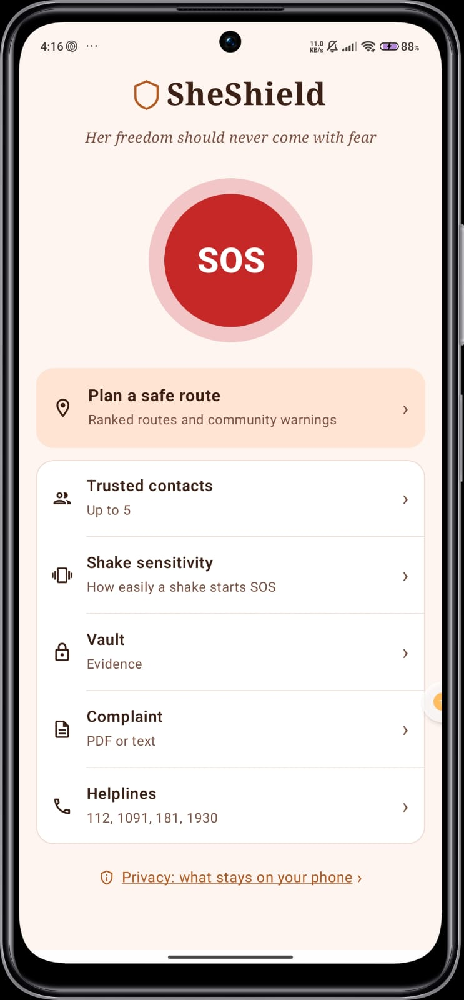
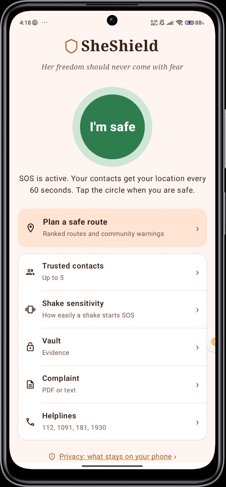
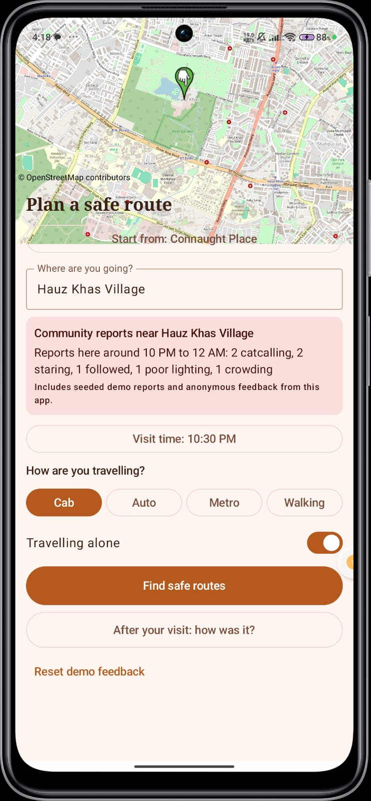
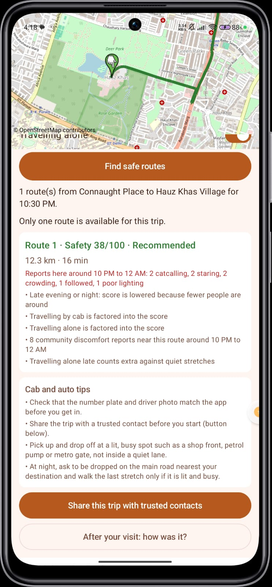
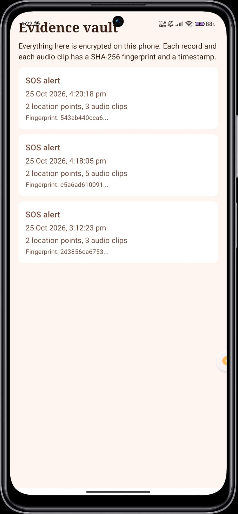
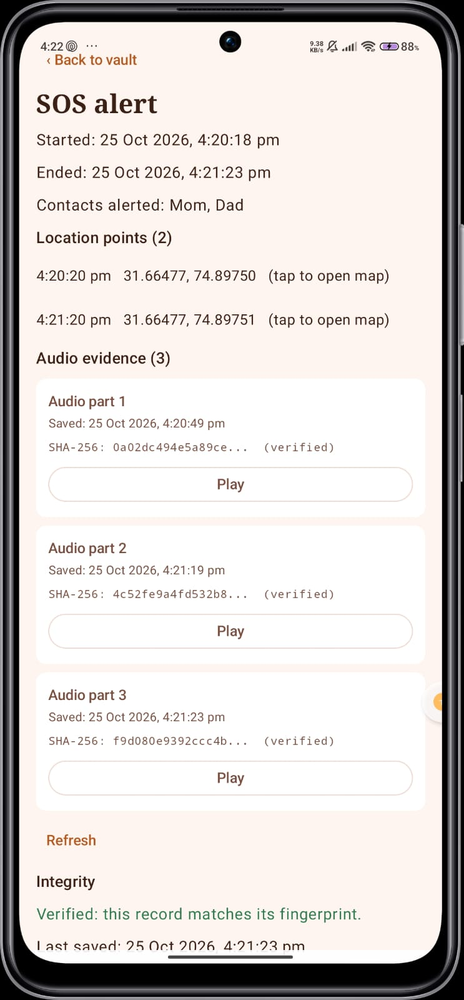
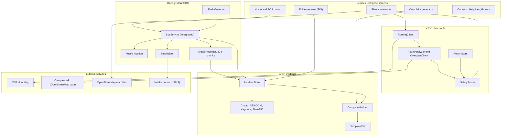

# SheShield

> Her freedom should never come with fear.

SheShield is a privacy-first women's safety app for Android. It covers the whole journey: **plan a safer trip before you go, ask for help silently while it is happening, and keep tamper-evident evidence and a ready complaint afterwards.**

Built for **recHERsion 2026** (Problem Statement 2: Women's Safety). Native Android, Kotlin and Jetpack Compose.

- Demo video: _link to be added_
- Presentation: _link to be added_
- Debug APK: see the **Releases** page of this repository

---

## The problem

Safety tools usually fix only one moment. Route apps pick the fastest road, not the safest one, and never say why. SOS apps often need the app open, an internet connection, or a visible button. After an incident, evidence is scattered across screenshots and memories, and writing a complaint from scratch is hard when you are shaken. Many apps also ask women to create accounts and upload sensitive data to a server.

## The solution: Before, During, After

| Stage | What SheShield does |
|---|---|
| **Before** | Explainable safe-route planner. Enter a destination, visit time, transport mode and whether you are alone. It ranks 2 to 3 routes, marks the recommended one and explains the score in plain language. Community warnings show up for the route and the destination. |
| **During** | Silent SOS. Shake the phone three times or tap the big button. After a 10-second cancel window, your trusted contacts get an SMS with a live Google Maps link, then an update every 60 seconds. Audio is recorded automatically. One tap on **I'm safe** stops everything and tells your contacts. |
| **After** | Encrypted evidence vault with a PIN. Every record and every audio clip has a SHA-256 fingerprint and a timestamp. A complaint letter is generated from the incident and exported as a PDF or shareable text. |

## Screenshots

| Home | Plan a safe route | Ranked routes and warnings |
|---|---|---|
|  |  |  |

| SOS active | Evidence vault | Complaint |
|---|---|---|
|  |  |  |

---

## Features

### Before: safe-route planner
- Map from OpenStreetMap (osmdroid). Pick a start place (Delhi demo places or your current location) and a destination.
- Visit time, transport mode (cab, auto, metro, walking) and a "travelling alone" switch.
- 2 to 3 alternative routes from OSRM, drawn in different colours by rank: green is recommended, then orange, then red.
- A 0 to 100 safety score per route with plain-language reasons, for example "Stays mostly on main roads", "Passes 4 shops or cafes", "Has a 400 m stretch with no shops nearby".
- Community warnings, shown only after a minimum number of reports (3), for the route and for the destination.
- A 3-tap post-visit feedback form ("How was it? Were you uncomfortable at any point?"). Warnings and scores update immediately.
- Cab and auto tips (check the number plate, pick-up and drop-off at lit and busy spots).
- **Share this trip** sends the route link and ETA to your trusted contacts by SMS.

### During: silent SOS
- Triggers: three strong shakes within two seconds (sensitivity can be adjusted) or the SOS button.
- A foreground service keeps SOS working with the screen off and the app in the background. Its notification is deliberately discreet and hidden on the lock screen.
- 10-second countdown with vibration and a cancel option, to avoid false alarms.
- SMS to up to 5 trusted contacts with a live location link, then updates every 60 seconds. SMS uses the mobile network, not mobile data.
- Audio recording starts automatically, saved in 30-second chunks so nothing is lost if the phone is switched off or taken.
- If Android refuses the microphone service type, SOS falls back to location-only so the alert itself never breaks.
- **I'm safe** stops the alert, saves the last audio chunk and sends an all-clear SMS.

### After: evidence vault and complaint
- Each incident is one encrypted file (AES-256-GCM, key kept in the Android Keystore) holding the time, location points, contacts alerted, notes and the list of audio clips.
- Each audio clip is encrypted separately and carries its own SHA-256 fingerprint and timestamp. Clips are decrypted only while they play. The vault shows whether each clip still matches its fingerprint.
- The vault is locked with a 4-digit PIN (stored only as a salted hash).
- **Complaint generator:** pick an incident, add your details, and get a letter addressed to the SHO with the incident summary, location points with map links, evidence list with fingerprints and a request for action. Export as a PDF or share as text.
- **Helplines:** tap to call 112, 1091, 181 and 1930 (cyber), with a short guide on where to file.

### Privacy screen
An in-app screen explains what stays on the phone, what is sent only when you choose, and which permissions are used and why.

---

## How the safety score works

Each route starts from a base score and is adjusted by:

| Input | Effect |
|---|---|
| Road type (main road or lane) | Main roads score higher, more so at night |
| Street lighting | Counted only where OpenStreetMap has lighting data. Missing data is neutral, never treated as unsafe |
| Shops and cafes within 100 m | More activity scores higher (per kilometre, so long routes are not favoured) |
| Police stations, hospitals, metro stations within 500 m | Small bonus |
| Isolated stretches (300 m or more with no mapped shops) | Penalty, larger at night, on foot and when alone |
| Time of day and transport mode | Walking at night is penalised more than a cab; travelling alone adds weight to risks |
| Community reports within 150 m of the route in the same 2-hour slot | Discomfort reports lower the score, "felt safe" reports raise it slightly. Counted only after 3 or more reports |

When detailed map data cannot be loaded, the score falls back to time of day, transport mode, whether you are alone and community reports, and the screen says so.

## Architecture



Everything the user creates (contacts, incidents, audio, feedback, caches) is stored on the device. There is no account and no SheShield server.

### Project structure

```
app/src/main/java/com/example/sheshield/
  MainActivity.kt, Navigation.kt      app entry, routes, home and privacy screens
  SheShieldApp.kt                     map user agent, caches, seeded data
  data/
    ContactStore, ContactsViewModel   trusted contacts (local)
    SosState, SosPrefs                SOS phase and shake sensitivity
    IncidentStore, Crypto, VaultLock  encrypted incidents, AES-GCM, PIN hash
    ComplaintBuilder, ComplaintPdf    complaint text and PDF export
    RoutingClient, RouteAnalyzer,
    OverpassClient, RouteContext      routes and OpenStreetMap context
    SafetyScorer                      safety score, ranking, reasons
    CommunityReport, ReportStore      community reports and warnings
    DemoPlaces, TripModels            demo places and trip request
  service/
    SosService, ShakeDetector, SmsHelper
  ui/
    OsmMap, PlanTripScreen, TripExtras
    VaultScreen, ComplaintScreen
    ContactsScreen, HelplinesScreen, OnboardingScreen
app/src/main/assets/reports_seed.json  35 seeded demo reports
```

## Tech stack

- Kotlin, Jetpack Compose (Material 3), Navigation Compose
- Foreground service, accelerometer, `MediaRecorder`, `SmsManager`
- Google Play Services fused location provider
- Android Keystore (AES-256-GCM), SHA-256, `PdfDocument`
- osmdroid with OpenStreetMap tiles
- OSRM for routing, Overpass API for OpenStreetMap context
- Minimum SDK 26

## Privacy-first design

| Stays on the phone | Sent only when you choose | Sent to public services |
|---|---|---|
| Trusted contacts, settings, incidents, audio, notes, feedback, complaint drafts | SMS with a location link to your trusted contacts during SOS or when you press Share trip | Start and destination points go to the OSRM routing server, route coordinates go to the Overpass API, and map tiles are loaded from OpenStreetMap |

- No account, no login, no analytics, no ads.
- Community feedback keeps only a category, a rough 100 m grid cell and a 2-hour time slot. No name, no phone number, no user ID.
- The PIN protects access to the vault and complaint screens. The encryption key itself lives in the Android Keystore and is not derived from the PIN.

---

## Setup

1. Clone the repository: `git clone https://github.com/codova01/SheShield.git`
2. Open the folder in a recent Android Studio (one that supports Android SDK 37). Let Gradle sync.
3. Connect a real Android phone (SMS, sensors and the microphone do not work properly on an emulator) and press **Run**.
4. On first launch, follow the onboarding screen and allow location, SMS, microphone and notification permissions.
5. Add at least one trusted contact. Use your own number to test.

Or install the debug APK from the **Releases** page.

### Try the demo

1. **Safe route:** Start from Connaught Place, destination **Hauz Khas Village**, time **10:00 PM**, **Cab**, **alone** on. See the ranked routes, the reasons and the community warning.
2. **Live feedback:** choose **Lajpat Nagar Central Market** at 10 PM. It shows "not enough reports yet". Submit one feedback report (uncomfortable, catcalling) and the warning appears.
3. **SOS:** shake the phone three times, or press SOS. Wait for the countdown, check the SMS on your contact's phone, wait about 40 seconds, then press **I'm safe**.
4. **Vault and complaint:** open the vault with your PIN, check the audio clip and its fingerprint, then generate the complaint and share it as a PDF.


## Future scope

- Hindi and Punjabi language support
- Fake incoming call and a journey timer that alerts contacts if you do not arrive
- Photo evidence in the vault
- A stalkerware check (audit of risky apps on the phone)
- A live backend that collects anonymous reports and validates them
- Biometric unlock for the vault
- Data-driven safest pick-up and drop-off suggestions

## Credits and data

- Map data and tiles: © OpenStreetMap contributors (ODbL)
- Routing: OSRM
- Map context: Overpass API
- Map library: osmdroid

Built for recHERsion 2026.
